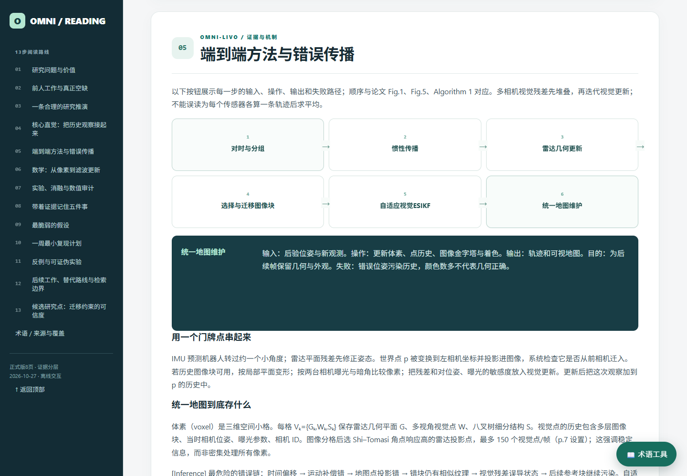
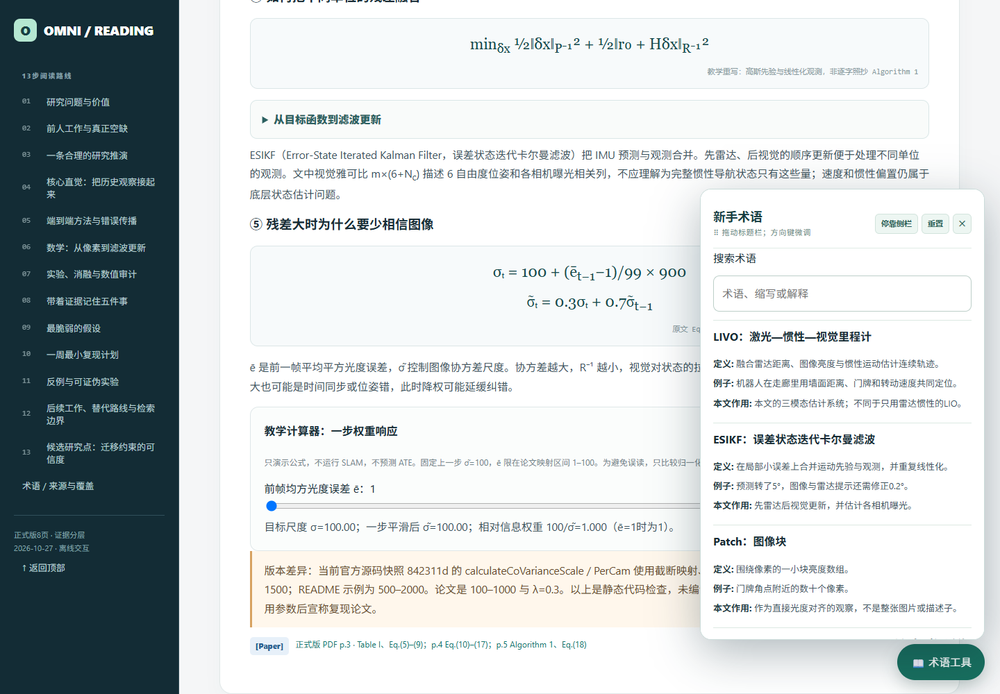

# paper-reading

**Evidence-grounded paper deep reading, critical analysis, and interactive HTML reports.**

English · [简体中文](README_CN.md)

[Quick start](#quick-start) · [Featured example](#featured-example) · [The 13-stage workflow](#the-13-stage-workflow) · [FAQ](#faq) · [Contributing](CONTRIBUTING.md)

A reusable Agent Skill for Codex and compatible agents. Start with a paper, understand its reasoning and evidence, and finish with an accessible report you can navigate and explore. The workflow adapts to the discipline and the reader's background.

## Featured example

### Omni-LIVO — from the paper to an interactive tutorial

[](https://zxinwang.github.io/paper-reading/examples/omni-livo/)

**[Open the interactive report →](https://zxinwang.github.io/paper-reading/examples/omni-livo/)** · [Download the HTML](https://github.com/zxinwang/paper-reading/raw/refs/heads/main/examples/omni-livo/index.html) · [Case notes and validation](examples/omni-livo/README.md)

This Chinese tutorial covers *Omni-LIVO: Robust RGB-Colored Multi-Camera Visual-Inertial-LiDAR Odometry via Photometric Migration and ESIKF Fusion*. It contains the full 13-stage analysis, a clickable pipeline, expandable mathematics, 27-sequence comparisons, an illustrative parameter model, and a searchable glossary that you can drag or dock.

| Explore the method | Keep the glossary at hand |
| --- | --- |
|  |  |

Generated by invoking `paper-reading`, then checked in a real desktop browser. The generation run passed 63 desktop checks; this is a report validation, **not a replication of the SLAM algorithm**. The paper PDF is not redistributed. Public-copy source links point to the publisher; the analysis and interactions are preserved. Robotics is one example, not a restriction on the Skill.

## What it does

| Capability | What you get |
| --- | --- |
| Understand the research | Problem, prior work, intuition, modules, assumptions, and failure propagation |
| Learn the technical details | First-use definitions, worked examples, important derivations, and a paper-specific glossary |
| Audit the evidence | Source markers, recalculated numbers, fair-comparison questions, and explicit uncertainty |
| Plan the next experiment | A resource-aware seven-day replication, falsification tests, and a testable candidate idea |
| Explore a real report | A complete title, sidebar navigation, diagrams, applicable interactive controls, and a movable glossary |
| Check publication context | Verified venue and separately sourced, dated journal metrics when applicable |

Reports distinguish **[Paper]**, **[Prior work]**, **[Inference]**, and **[Hypothesis]**. A teaching model is labeled as such; a plausible interpretation is not presented as a measured result.

## Quick start

### 1. Install in Codex

Clone into the current documented user Skill directory. Do not overwrite an existing installation or install duplicate copies with the same Skill name.

```bash
mkdir -p ~/.agents/skills
git clone https://github.com/zxinwang/paper-reading.git ~/.agents/skills/paper-reading
```

Windows PowerShell:

```powershell
New-Item -ItemType Directory -Force "$env:USERPROFILE\.agents\skills" | Out-Null
git clone https://github.com/zxinwang/paper-reading.git "$env:USERPROFILE\.agents\skills\paper-reading"
```

For one project, use `<project>/.agents/skills/paper-reading` instead. Codex detects local Skill changes; restart it if the Skill does not appear. Older Codex versions may use different discovery locations. See [official OpenAI guidance](https://learn.chatgpt.com/docs/build-skills) and the [Agent Skills specification](https://agentskills.io/specification).

### 2. Give it a paper

```text
Use $paper-reading to deeply read this paper: <PDF path, DOI, or URL>.
Explain the background, method, mathematics, experiments, and limitations
for a beginner. Investigate related and follow-up work, and generate
a complete interactive HTML report in English.
```

```text
使用 $paper-reading 深度精读这篇论文：<PDF路径或论文链接>。
面向初学者解释方法、数学推导、实验、局限和后续研究，
并生成完整的交互式中文 HTML 报告。
```

### 3. Open the result

A full review normally creates an actual HTML file. Open it in a browser and use the contents, diagrams, controls, and glossary. The agent must report what it actually checked. A narrow question or an explicitly requested alternative format stays within that scope.

## Input / output

**Input:** a local PDF, DOI, paper title, or accessible URL. Appendices, supplements, official code, and data improve coverage. State the language, your background, focus, and available replication resources if relevant.

**Output:** a source-grounded tutorial, a real interactive HTML file for a full review, and actual validation notes. Features adapt to the paper: a qualitative study should not acquire invented equations, and an inaccessible table should not acquire invented numbers.

The bundled design uses a dark teal cover, mint accents, desktop sidebar, readable cards, and a draggable/dockable glossary. Core content, SVGs, formulas, and scripts are embedded where possible. References may need internet access. A parameter demonstration explains stated assumptions; it does not predict real experimental performance.

## The 13-stage workflow

| Stage | Research question |
| --- | --- |
| 01 · Problem and value | What problem is being solved, and why does it matter? |
| 02 · Prior work and gap | What already works, and what remains unresolved? |
| 03 · Research-path reconstruction | What reasoning could lead from the gap to a candidate approach? |
| 04 · Core intuition | What is the mechanism before the technical detail? |
| 05 · Method pipeline | What enters each module, what changes, and what can fail? |
| 06 · Mathematics and theory | Which equations matter, under which assumptions? |
| 07 · Experiments and evidence | What was tested, against what, and what remains unproven? |
| 08 · Takeaways | Which lessons are supported by the evidence? |
| 09 · Fragile assumption | Which assumption could undermine the method? |
| 10 · Seven-day replication | What small, discriminative experiment is feasible? |
| 11 · Counterexamples | What would weaken or falsify the claim? |
| 12 · Follow-up research | What independent, later, alternative, or conflicting evidence exists? |
| 13 · Candidate research idea | What testable next direction survives a novelty check? |

## Use cases

- Prepare a journal club, seminar, or critical paper discussion.
- Enter an unfamiliar field without skipping foundational terminology.
- Audit experimental claims and plan a small replication.
- Identify limitations, design counterexamples, and investigate a candidate direction.

## FAQ

**Is it limited to AI or robotics?** No. The workflow is domain-agnostic and adapts methods, terminology, mathematics, and evaluation to the paper.

**Does it require a particular model or paid API?** The repository is an instruction-and-resource Skill, not a hosted reading service. It uses the capabilities and tools of the agent running it. PDF extraction, retrieval, and browser validation require those tools to be available.

**Does every paper produce the same interactions?** No. At least three meaningful interactions are requested when the content supports them. Unsupported simulations, fabricated data, and decorative controls are not substitutes.

**Does it guarantee correctness, novelty, or successful replication?** No. Missing access, ambiguous formulas, incomplete searches, and unexecuted experiments must be disclosed. Journal metrics do not establish the quality of an individual article. Users should verify consequential conclusions.

**Does it publish reports automatically?** No. Creating a local report is separate from publishing it. Only material the user authorizes should be uploaded.

## Project structure

```text
paper-reading/
├── SKILL.md
├── README.md / README_CN.md
├── CONTRIBUTING.md
├── .gitignore / .nojekyll
├── index.html
├── references/report-workflow.md
├── assets/
│   ├── report-shell.html
│   ├── report.css
│   ├── glossary-panel.css
│   └── glossary-interactions.js
├── scripts/validate_resources.py
└── examples/omni-livo/
    ├── index.html
    ├── README.md
    ├── numeric-audit.json / provenance.json / validation.json
    └── preview.png / method.png / glossary.png
```

There is one canonical `SKILL.md`. `references/` supplies detailed report requirements; `assets/` supplies the reusable interface. The example is an output, not a second Skill.

## Contributing and feedback

Read [CONTRIBUTING.md](CONTRIBUTING.md). Report reproducible problems through [Issues](https://github.com/zxinwang/paper-reading/issues), or propose changes with a pull request. Keep private papers, personal data, and credentials out of public reports.

No project license has been selected. Public availability alone does not grant reuse or redistribution rights. The example paper and linked research retain their own rights.
