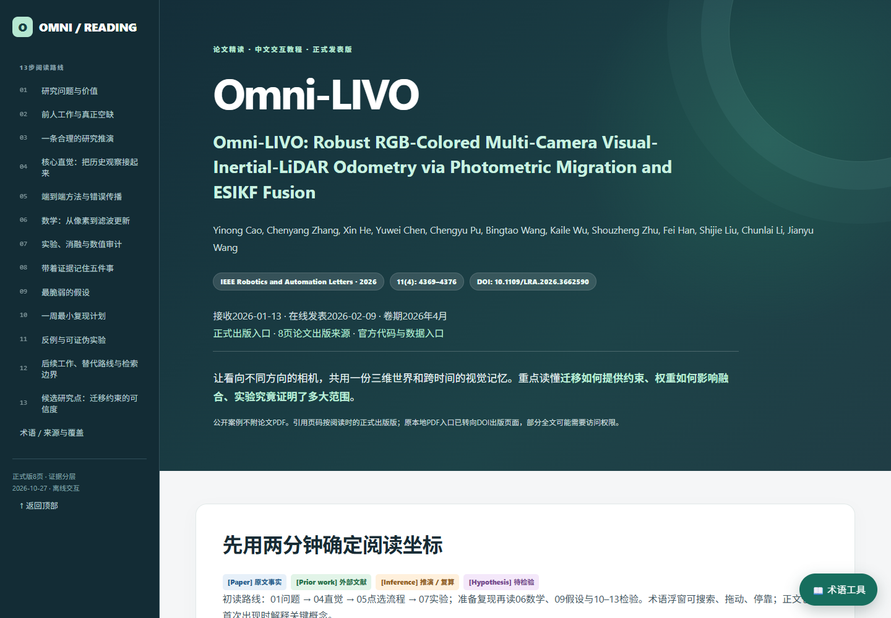

# Omni-LIVO · interactive paper-reading example

[Open the report online](https://zxinwang.github.io/paper-reading/examples/omni-livo/) · [Download HTML](https://github.com/zxinwang/paper-reading/raw/refs/heads/main/examples/omni-livo/index.html)

**Paper:** Omni-LIVO: Robust RGB-Colored Multi-Camera Visual-Inertial-LiDAR Odometry via Photometric Migration and ESIKF Fusion. IEEE Robotics and Automation Letters 11(4):4369–4376, 2026. [Publisher DOI](https://doi.org/10.1109/LRA.2026.3662590).

This Chinese beginner tutorial was generated by an independent agent explicitly invoking the updated `paper-reading` Skill using the paper PDF and Skill resources. The parent agent reviewed it without patching its scientific content. The generation agent performed its own normal drafting, browser testing and repairs.

## Explore

- Full original title and bibliographic information.
- All 13 research stages, with sources and uncertainty labels.
- Six-stage interactive pipeline and expandable mathematical explanations.
- 27 original-table sequence comparisons; [transcribed data and calculations](numeric-audit.json).
- A clearly labeled parameter teaching model.
- Searchable glossary with mouse dragging, docking, floating, reset and keyboard controls.

## What was checked

Original generation: 63 desktop checks passed in an offline Chromium browser; actual screenshots reviewed. Source access included the 8-page published paper, selected current official code/configuration, and primary related-work pages at the depth disclosed in the report. The agent did not run SLAM, collect hardware data, or reproduce the paper's experiments. Mobile validation was explicitly omitted.

Public preparation changes local source/validation links and publication notes; it does not change the scientific analysis or interaction code. The paper PDF is not included. Page markers still refer to the published version read by the agent; source links now open the DOI landing page, which may require institutional access for full text. Scientific analysis and interactions are retained. Hashes and packaging details: [provenance.json](provenance.json). Public-copy browser checks: [validation.json](validation.json).

The example preserves important limits: 25/27 refers to the collection of variants; mean per-sequence reduction differs from reduction of mean error; return alignment is not proof of an implemented online loop-closure module. Unverified journal quartiles are not guessed.

机器人只是本案例的学科。报告验证不等于算法复现；教学模型、候选研究和未完成核查均在报告中标明。公开副本不包含论文PDF。
